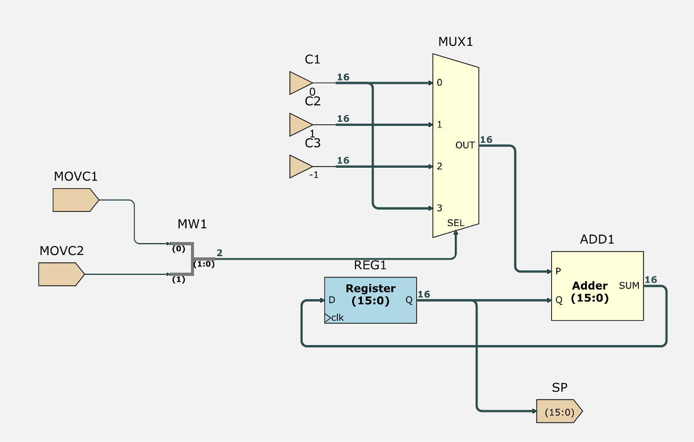
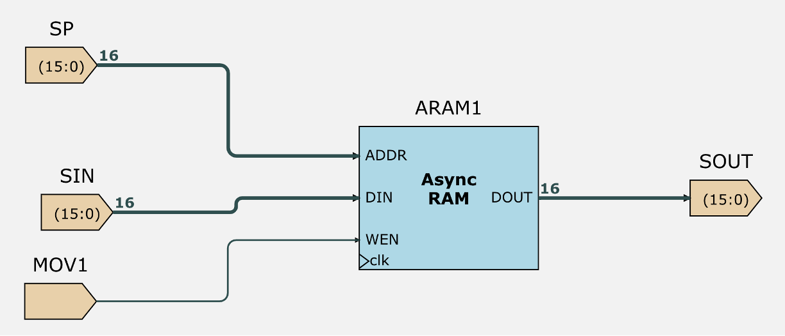

This is the total setup and test code of lab3 challenge.

Two extra structure are added: SPMOD and INT_STACK.

SPMOD:

INT_STACK:

SPMOD modifies the Stack Pointer(SP) and INT_STACK stores the values.
